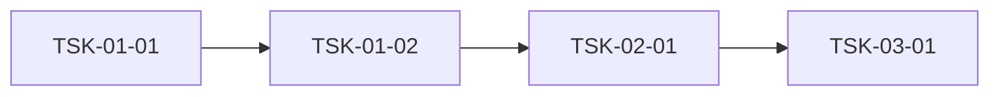

# WBS - 합성 샘플 (3단)

> version: 1.0
> depth: 3
> start-date: 2026-11-02 / target-date: 2026-12-18 / updated: 2026-10-19
> source: docs/PRD.md, docs/TRD.md

---

## Dev Config

### Domains
| domain | description | unit-test | e2e-test | e2e-server | e2e-url |
|--------|-------------|-----------|----------|------------|---------|
| backend | 서버 API | `npm run test` | - | - | - |
| frontend | 화면 | `npm run test` | `npx playwright test` | `npm run dev` | `http://localhost:3000` |
| fullstack | 화면 + 서버 | - | - | - | - |

### Quality Commands
| name | command |
|------|---------|
| lint | `npm run lint` |

### Cleanup Processes
node

## WP-01: 프로젝트 초기화
- phase: 착수
- schedule: 2026-11-02 ~ 2026-11-06
- description: 저장소·CI·공통 설정을 준비한다

### TSK-01-01: 저장소와 CI 구성
- category: infra
- domain: backend
- model: sonnet
- status: [ ]
- priority: critical
- assignee: -
- schedule: 2026-11-02 ~ 2026-11-03
- tags: m0, setup
- depends: -
- blocked-by: -
- entry-point: -
- note: -

#### PRD 요구사항
- prd-ref: TRD 3.1
- requirements:
  - 저장소를 만들고 기본 브랜치 보호를 건다
  - CI 에서 lint·test 를 돌린다
- acceptance:
  - main push 시 CI 가 초록이다
  - 보호 규칙이 force push 를 막는다
- constraints: -
- test-criteria:
  - npm run test

#### 기술 스펙 (TRD)
- tech-spec:
  - GitHub Actions
- api-spec: -
- data-model: -
- ui-spec: -

### TSK-01-02: 공통 설정 모듈 (계약 전용)
- category: infra
- domain: backend
- model: opus
- status: [dd]
- priority: high
- assignee: dev1@example.com
- schedule: 2026-11-04 ~ 2026-11-06
- tags: contract
- depends: TSK-01-01
- entry-point: -

#### PRD 요구사항
- requirements: 설정 로더를 둔다, 환경별 값을 분리한다
- acceptance:
  - 실행 로직 없음 (contract-only)
  - 설정 키 목록이 문서와 같다
    - 키 이름은 SCREAMING_SNAKE
    누락 키는 기동 시 실패한다
- constraints:
  - 비밀값을 저장소에 넣지 않는다
- test-criteria: -

#### 기술 스펙 (TRD)
- api-spec:
  - GET /config → { env, features }
  - 응답은 캐시하지 않는다
- data-model:
  - Config(env, features[])

## WP-02: 회원 기능
- phase: 구현
- schedule: 2026-11-09 ~ 2026-11-27

### TSK-02-01: 회원 가입 화면
- category: dev
- domain: fullstack
- model: sonnet
- status: [im]
- priority: medium
- assignee: -
- schedule: 2026-11-09 ~ 2026-11-13
- tags: -
- depends:
  - TSK-01-02
  - TSK-01-01
- entry-point: 사이드바 > 회원 > 가입
- description: 가입 폼과 검증을 한 화면에 둔다

#### PRD 요구사항
- prd-ref: PRD 4.2, program:MB-001
- requirements:
  - 이메일·비밀번호로 가입한다
- acceptance: 가입 후 로그인 화면으로 간다, 중복 이메일은 거부한다
- constraints:
  - 비밀번호는 해시로만 저장한다
- test-criteria:
  - 가입 e2e 1건

예시 블록(펜스 안 WP/ACT 헤딩은 블록 경계가 아니다):

```markdown
## WP-99: 펜스 안 예시
### ACT-99-01: 펜스 안 예시
- acceptance:
  - 무시돼야 한다
```

#### 기술 스펙 (TRD)
- api-spec:
  - POST /api/members
- data-model: -

### TSK-02-02: 회원 목록 (상태 표기 확인)
- category: dev
- domain: backend
- model: sonnet
- status: [xx]
- priority: low
- assignee: -
- schedule: 2026-11-16 ~ 2026-11-20
- tags: list,  paging ,
- depends: TSK-02-01
- entry-point: -

#### PRD 요구사항
- requirements:
  - 목록을 20건씩 보여 준다
- acceptance:
  - 페이지 이동이 된다

### TSK-02-03: 회원 탈퇴
- category: feat
- domain: backend
- status: [fp]
- priority: medium
- schedule: 2026-11-23 ~ 2026-11-27
- depends: -

## WP-03: 통합테스트
- phase: 구현
- schedule: 2026-11-30 ~ 2026-12-18
- description: 기능 간 시나리오 E2E

### TSK-03-01: 가입→목록 흐름
- category: itest
- domain: test
- model: sonnet
- status: [ ]
- priority: high
- assignee: -
- schedule: 2026-11-30 ~ 2026-12-04
- tags: integration, e2e
- depends: TSK-02-01, TSK-02-02
- entry-point: -

#### PRD 요구사항
- requirements:
  - 가입한 회원이 목록에 보인다
- acceptance:
  - 시나리오 통과
  - 발견 결함은 해당 기능 WP에 defect Task로 등록됨

## 의존 그래프

### 그래프 (Mermaid)



### 통계

| 항목 | 값 | 임계값 |
|------|-----|--------|
| 최장 체인 깊이 | 3 | 3 초과 시 검토 |
